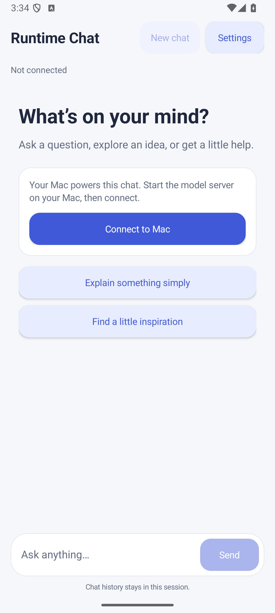

# Android chat client

The native Kotlin app in `android/` is another client of our existing runtime.
The phone displays the conversation and sends HTTP requests. **The Mac still
loads the model and does inference.** No model weights, Python, Transformers, or
PyTorch are installed on the phone. The browser and Android app can use the same
running server independently.



## Run it with Android Studio

1. Start the server from the repository root. For real answers with the model
   already downloaded during the previous milestone:

   ```bash
   LLM_MODEL_PATH=.models/qwen2.5-0.5b .venv/bin/python -m uvicorn llm_runtime.local:create_local_app --factory --host 127.0.0.1 --port 8000
   ```

   Alternatively use `.models/smollm2`, or start the default simulator with
   `.venv/bin/python -m uvicorn llm_runtime.api:app --port 8000`. The simulator
   tests communication but does not produce real answers. See [LOCAL_MODEL.md](LOCAL_MODEL.md)
   for installing the optional Python dependencies and downloading a model.

2. Open the **`android/` folder** as a project in Android Studio. Let Gradle sync.
   Use a Gradle JDK of 17 or 21; Android Studio's bundled JBR 21 was verified.
   Install Android SDK Platform 35 and Build Tools 35.0.0 if prompted. The project
   pins AGP 8.8.0, Kotlin 2.0.0, and Gradle 8.10.2 with its published SHA-256.
   These versions match the installed toolchain; they are not claimed as latest.
3. Create or select an Android emulator (Android 8/API 26 or newer; API 35 was
   tested), select the **app** configuration and **debug** build variant, and Run.
4. Tap **Connect to Mac** on the welcome screen. The default address is
   **`http://10.0.2.2:8000`**, available under **Settings**. This special emulator
   address reaches the Mac's loopback interface. The emulator's `127.0.0.1`
   refers to the emulator itself.
5. Type in the bottom message bar and tap **Send**. Replies appear in message
   bubbles as they arrive. Send becomes **Stop** while the model writes;
   **New chat** clears this client's conversation. Example prompts on the welcome
   screen fill the message box without sending anything automatically.

## Chat screen and Settings

The main screen shows the conversation and a simple connection status. Tap that
status to inspect the server/model and detailed errors. Server addresses, model
aliases, and token counts stay out of the main chat view.

**Settings → Maximum reply length** offers **Short (64 tokens)**,
**Medium (192)**, and **Long (512)**. Short preserves the original default.
**Advanced** exposes the exact token limit from 1 to 512; these are maximum
output lengths, not word counts, and answers can finish sooner. A reply that
reaches its limit gets an explanatory note. Changing the connected server starts
a new chat; changing reply length keeps the current conversation.

Light and dark colors follow Android's system theme. The message bar stays at the
bottom above the keyboard. Rotation retains messages, drafts, and saved settings;
the view follows the latest reply when already at the bottom and lets you scroll
back to read earlier messages. Unsaved Settings edits are discarded when that
dialog is cancelled or the Activity is recreated.

The first Gradle sync can download build tools and library dependencies into
Gradle/Android SDK caches on your Mac. It does not download another language
model. The running emulator also uses Mac memory; stop it in Android Studio when
finished. Build outputs remain under ignored `android/app/build/`.

## A real Android phone

Two development options are available; a physical phone was not verified in this
milestone:

- **USB, without exposing the server on Wi-Fi:** enable Android developer options
  and USB debugging, connect and authorize the phone, then run
  `adb -s PHONE_SERIAL reverse tcp:8000 tcp:8000`. Install/run the debug app and
  set `http://127.0.0.1:8000` under Settings and save/connect. Remove the forwarding afterward
  with `adb -s PHONE_SERIAL reverse --remove tcp:8000`.
- **Trusted Wi-Fi:** put both devices on the same network, start Uvicorn with
  `--host 0.0.0.0` instead of `127.0.0.1`, and enter
  `http://MAC_LAN_IP:8000` in the app. Allow the local connection if macOS Firewall
  prompts. Some guest networks block connections between devices. Stop this
  server when finished and return to the loopback command for normal local use.

The current server has no authentication. Keep this development service on your
own trusted network; do not port-forward it onto the internet. Debug builds allow
HTTP to reach the local runtime. Release builds disallow cleartext HTTP and need
an HTTPS server. HTTPS hosting, authentication, release signing, Play Store
distribution, and offline/on-device inference are separate work.

Native Android networking does not need a browser CORS exception. We did not
change the server's browser-origin policy or add server endpoints.

## How it works

```text
Android screen → GET /v1/models → model alias
Android screen → POST /v1/chat/completions → existing queue/scheduler
               ← streamed SSE text       ← PyTorch + model + per-request KV cache
Stop           → POST /requests/{raw request ID}/cancel
```

- `MainActivity.kt` presents native message bubbles, a bottom composer,
  connection details, and a scrollable Settings dialog. System/keyboard insets,
  accessible button labels, selectable reply text, and light/dark resources are
  handled in the Android presentation layer. Networking runs off the UI thread.
- `ChatModel.kt` owns conversation state and background work. A ViewModel keeps
  the current request, structured display turns, and draft across rotation.
  `ChatTurn.kt` holds display-only reply/finish notes; the separate `Conversation`
  still owns accepted API history. Finishing the Activity
  cancels active work; moving the app to the background alone does not cancel it.
  Android can kill a background process, so generation is not a durable job.
- `RuntimeClient.kt` discovers the model and sends the complete accepted history
  with greedy settings. It reads UTF-8 incrementally and requires the server's
  completion metadata and `[DONE]` before treating a reply as successful. HTTP
  errors and connection failures get simple status messages with details on tap;
  there are no
  automatic generation retries that might create duplicate requests.
- `ChatProtocol.kt` handles SSE framing, request identity, finish/usage validation,
  request JSON, and history limits. A truncated stream is a failure, even if some
  answer text already arrived. Event and discovery/error response sizes are bounded.
- Stop uses the raw `X-Request-ID` header, not the `chatcmpl-` completion ID. Socket
  closure is the fallback when headers have not arrived or cancellation fails.
  The scheduler still owns safe-step cleanup and memory release. The UI may show
  “Stopping…” until the network worker exits; it does not interrupt a PyTorch
  calculation halfway through.
- Failed/stopped turns remain visible with a marker but are not sent as history.
  Successful empty replies are also excluded because the API requires nonempty
  history messages. New chat and changing the connected server clear history.
  Each client has its own independent history; opening the browser does not show
  the Android conversation.
- Chat text is held only in process memory. It survives rotation, but is lost
  when the app process ends; no chat database, analytics, or model download is
  included. The app requests only the Internet permission.

The API's 64-message/8,192-character limits are checked before sending, and the
server separately enforces tokenized context and KV capacity. The app does not
silently discard old turns. Start a new chat when the limit is reached. This is
a small English-language development client, not a fully localized chat product.

## Build and test

From `android/`, with `JAVA_HOME` set to a compatible JDK and the SDK configured
through Android Studio's untracked `local.properties` or `ANDROID_HOME`:

```bash
./gradlew :app:testDebugUnitTest :app:lintDebug :app:assembleDebug :app:assembleRelease
```

The installable development APK is `android/app/build/outputs/apk/debug/app-debug.apk`.
The release APK is unsigned; it is a build check, not a published app. Never commit
`local.properties`, build caches, signing keys, or generated APKs.

JVM tests use JUnit, a real JSON implementation, and test-only MockWebServer.
They cover SSE framing and UTF-8 byte splits, completion/usage/identity errors,
history and input limits, HTTP discovery/generation, server rejection, early EOF,
explicit cancellation, and Stop before headers/start. MockWebServer/OkHttp are
not included in the installed app; production networking uses Android's
`HttpURLConnection`.

An opt-in end-to-end smoke drives an already installed debug app in a running
emulator against a **dedicated idle runtime**, with no other requests:

```bash
.venv/bin/python scripts/verify_android_client.py --adb "$ANDROID_HOME/platform-tools/adb"
```

Run that from the repository root with a real model server on port 8000. The
script resets this app's in-memory chat, sends model requests, temporarily changes
emulator rotation, system theme, and font scale (restoring their previous settings),
checks message widths and retained history, exercises Settings, checks two simultaneous
clients and cancellation/zero KV state, checks offline/reconnect behavior, and
writes screenshots plus `smoke.json` under ignored `.experiments/android-client/`.
It accepts explicit server addresses and emulator serials; it refuses physical
device serials because it changes device settings. The follow-up text must match
a separate greedy JSON API request with the exact same accepted history; use the
verified Qwen checkpoint for this smoke. This checks client agreement, not whether
the model's answer is factually correct. It is not a performance benchmark.

The initial client verification recorded **26 Android tests and 444 Python tests
passed**; debug and unsigned release builds passed. The
[original API 35/Qwen emulator record](android/verification/qwen-api35.json) includes
direct-response agreement, two-client admission, cancellation, and final zero
request/KV state. The interface update is recorded separately in
[the polished-client record](android/verification/polish-api35.json) and
[PROGRESS.md](PROGRESS.md). A physical phone has not been tested.

The Python runtime remains independently checked with `.venv/bin/python -m pytest -q`.
See [PROGRESS.md](PROGRESS.md) for further details and remaining limits.

## References

- [Android emulator host addresses](https://developer.android.com/studio/run/emulator-networking-address)
- [Android network security and cleartext defaults](https://developer.android.com/privacy-and-security/security-config)
- [AGP 8.8 compatibility requirements](https://developer.android.com/build/releases/agp-8-8-0-release-notes)
- [ADB reverse forwarding](https://developer.android.com/tools/adb#reverse)
- [Our chat API contract](CHAT_API.md)
