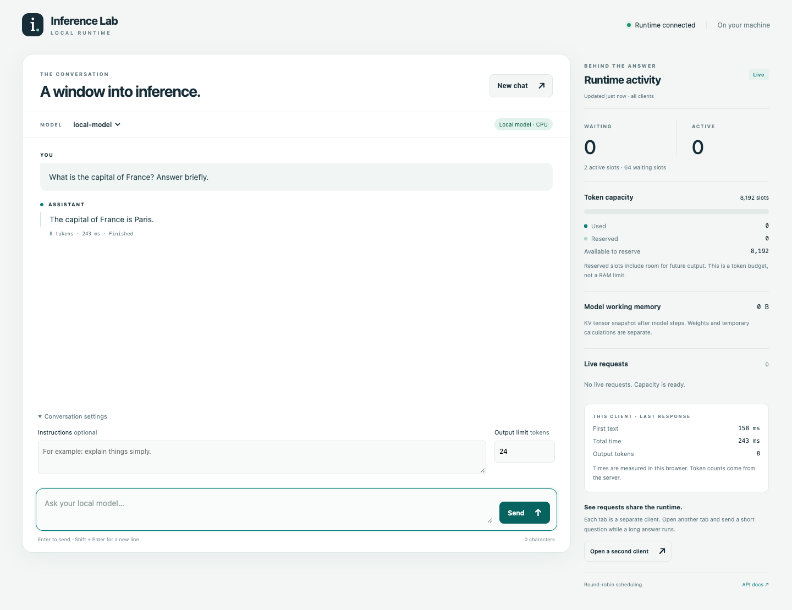

# Local browser client and HTTP measurements

The runtime now serves its own small chat client at `/`. It uses the existing
text-only chat API with streamed responses and zero-temperature generation.
There is no frontend build step, npm installation, separate UI server, or hosted
service. The browser requests the Python server on the same origin.

## Open the real model client

From the repository root:

```bash
source .venv/bin/activate
LLM_MODEL_PATH=.models/smollm2 uvicorn llm_runtime.local:create_local_app \
  --factory --host 127.0.0.1 --port 8000
```

Then visit **http://127.0.0.1:8000/** in your browser. The existing local model
setup in [LOCAL_MODEL.md](LOCAL_MODEL.md) must already be installed/downloaded.
This milestone adds no new model weights. The page identifies the real backend
as `Local model · CPU` and discovers the `local-model` alias automatically.

For the lightweight simulator instead:

```bash
uvicorn llm_runtime.api:app --host 127.0.0.1 --port 8000
```

The page labels that mode `Simulation`; it repeats words rather than answering
questions. Both servers use the same browser assets. Keep one Uvicorn worker.
Static assets are included in the Python wheel, so installed packages work too.



## Using the page

- Type a question and press Enter or Send. Shift+Enter inserts a newline.
- Open Conversation settings for optional instructions and an output limit from
  1 to 512 tokens. The page defaults to 64; this does not change the API's default.
- Read the answer as text arrives. Text is rendered literally, not executed as
  HTML or interpreted as Markdown.
- Press Stop to call the existing cancellation endpoint. If response headers have
  not arrived, or cancellation cannot be reached, the page closes the stream.
  Stream closure also notifies the scheduler, so a queued request releases its
  waiting place even when both model slots are busy. Active model work still
  settles at a safe boundary before its cache is released.
  Native work still cleans up cooperatively; Stop cannot interrupt CPU code.
- New chat clears the messages held by this tab. It is disabled during a request;
  stop or finish generation first. Conversation settings remain available.

Each tab holds independent in-memory conversation history. Previous completed,
nonempty replies are replayed as user/assistant pairs. Failed, cancelled, and
empty replies remain visible but are excluded from future context. Refreshing
or closing the page discards its history. There is no account, localStorage
conversation database, or server-side chat persistence.

The page checks the supported API's message-count and combined content limits
before submission. It reports validation/network errors, rejects incomplete
streams instead of calling them completed, and only enables Send when connected
with a discovered model. Reply completion requires a finish reason, usage, and
`[DONE]`. Only one request runs per tab at a time.

## Watch the engine work

The runtime sidebar polls `/health` (every 500ms while visible, less often in a
hidden tab). It shows all live requests on this server, including other clients:

- Waiting and active counts, plus the configured capacities.
- Request phase, prompt progress, output count/limit, and cancellation intent.
- Logical token slots used, reserved, and available for new reservations.
- Real KV tensor bytes after settled steps when provided by the backend.
- Browser-observed first-text and total time, plus final server token usage for
  this tab's last successful response. A cancelled reply has no final token total.

Logical token slots and real tensor bytes are intentionally separate. Neither
meter represents total RAM use. Health snapshots can miss very short phases and
brief allocation peaks. Offline snapshots are explicitly marked stale; they are
not reset to misleading zeros. Prompt contents and token IDs are not included in
the new `request_states` telemetry. Finalized requests disappear from that list.

To demonstrate concurrent scheduling:

1. Set the output limit to 512 and request a long numbered list.
2. Use **Open a second client** to open another tab.
3. Ask a short question in the second tab. Both share the same backend and sidebar
   state, but have separate conversation history.
4. Stop the long answer. After in-flight work settles, its reservation and KV
   cache are released. Active model forwards remain serialized, not tensor-batched.

## Measure the external HTTP path

The original benchmark submits directly to a scheduler. The new benchmark is a
separate HTTP client and requires a running local server:

```bash
python -m llm_runtime.http_benchmark --base-url http://127.0.0.1:8000 \
  --requests 8 --concurrency 2 --warmup 2 --max-tokens 24
```

It uses HTTPX from the development extra, discovers the model, and records health
configuration. It accepts localhost/loopback URLs, not hosted targets. Workload
clients share a connection pool, send one request at a time per worker, and do
not retry. Metadata, one streaming compatibility preflight, and warmup run before
the measured interval; failed preflight or warmup aborts. Each measured request has
a total deadline. After recording `[DONE]`, the client
drains the HTTP ending before returning the connection to the pool; extra SSE
data after `[DONE]` is an error. Completion latency remains the marker receipt
time, while the total deadline also bounds response draining.

Reports distinguish:

| Measurement | Meaning |
| --- | --- |
| `headers` | Submission to receiving response headers |
| `first_content` | Submission to receiving the first nonempty text delta |
| `completion` | Submission to receiving `[DONE]` after validated finish and usage |
| `content_delta_gap_ms` | Gaps between received nonempty deltas |
| Token throughput | Completed server-reported output tokens / full measured elapsed time |

These are client receipt times. Role-only chunks do not count as first text, and
network buffers may combine multiple deltas. Delta gaps are not necessarily model
token gaps. Reports include raw samples, nearest-rank percentiles, workload/model
metadata, completion/rejection/error/timeout counts, and throughput. Invalid or
mixed response identities, malformed/truncated streams, server errors, and timeouts
are excluded from successful latency distributions. Measured failures return
exit code 1; warmup/setup failures also return nonzero.

The default profile requires final token usage. For other local servers, explicit
model selection, configurable readiness, portable metadata behavior, and optional
latency-only modes are documented in
[HTTP compatibility checks](benchmarks/http-compatibility.md). Preflight-only mode
checks a single stream without measuring a workload. It may warm a prefix cache.

Recorded real CPU runs and their limitations are in
[benchmarks/http-local.md](benchmarks/http-local.md). No model speedup or production
capacity claim follows from these short runs.

## Verification tools

```bash
python -m pytest -q
node --test tests/browser_stream.test.mjs
```

The Python suite runs the JavaScript parser tests when Node 20+ is available;
otherwise that wrapper skips. The client itself needs no Node runtime.

For full browser testing against a running **real-model** server:

```bash
python -m pip install -e '.[dev,local,browser]'
python scripts/verify_browser_client.py --base-url http://127.0.0.1:8000
```

The optional `browser` extra installs Playwright, used only for QA. By default the
script launches an already installed Google Chrome in headless mode; no browser
was downloaded for this milestone. For Playwright's Chromium, install its browser
separately and use `--channel chromium`. Screenshots go to a temporary directory,
or an explicit `--output-dir`.

The check exercises real answers, history replay, two overlapping clients, Stop,
context cleanup, and New chat. Browser-side fixtures separately exercise literal
HTML text, truncated responses, failed-turn history exclusion, stale health and
recovery. Layout is checked at 390px and 320px. This is functional verification,
not an accessibility audit or a browser performance benchmark.

Recorded verification: [browser-client-smoke.json](benchmarks/browser-client-smoke.json).
The app remains local: no public deployment, authentication, persistent chat
storage, Markdown rendering, file uploads, or tools were added.
