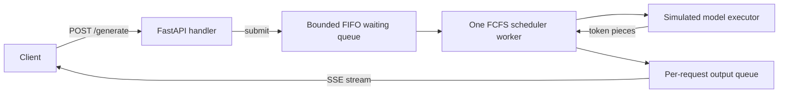

# LLM Inference Runtime

A miniature inference serving system inspired by vLLM, built to make scheduling
and concurrency understandable. Version 0.1 uses Python, FastAPI, asyncio, and a
**simulated executor**. It does not load model weights or perform real inference.

## Run it

Requires Python 3.10 or newer (development verified with Python 3.12).

```bash
python3.12 -m venv .venv
source .venv/bin/activate
python -m pip install -e '.[dev]'
uvicorn llm_runtime.api:app --host 127.0.0.1 --port 8000
```

Use one Uvicorn worker: every process owns a separate queue and scheduler. Multiple
workers would not share FCFS ordering or queue capacity.

In another terminal:

```bash
curl -N http://127.0.0.1:8000/generate \
  -H 'Content-Type: application/json' \
  -d '{"prompt":"hello world", "max_tokens":3}'
curl http://127.0.0.1:8000/health
```

`-N` disables curl's output buffering. API documentation is at `/docs`.
The POST endpoint streams Server-Sent Events (SSE):

```text
event: token
data: {"request_id": "...", "index": 0, "text": "hello "}

event: token
data: {"request_id": "...", "index": 1, "text": "world "}

event: token
data: {"request_id": "...", "index": 2, "text": "hello "}

event: done
data: {"request_id": "...", "generated_tokens": 3, "finish_reason": "length"}

```

Blank lines separate events. Token indices are zero-based; concatenate `text`
fields to reconstruct the output. The request ID is also in `X-Request-ID`.
A browser client should use streaming `fetch` because this endpoint uses POST;
native `EventSource` uses GET. Clients must handle frames split across network
chunks. Network chunks do not necessarily correspond to complete SSE events.

`prompt` must have 1–8192 characters. `max_tokens` is an integer from 1–512,
defaulting to 16. The simulator splits the prompt on whitespace and cycles its
words, appending a space to each generated piece. An all-whitespace prompt emits
`<empty> ` pieces. These pieces are called tokens for the exercise; they are not
real model tokens. Generation always stops at `max_tokens`; EOS is not modeled.

Invalid input returns HTTP 422. A full waiting queue or unavailable scheduler
returns HTTP 503 before a stream starts. After HTTP 200 begins, executor failures
and runtime shutdown are reported as terminal `event: error` frames, containing
`request_id` and `message`. HTTP status cannot change after headers are sent.
There is no automatic retry or durable request storage.

## Architecture



| Module | Responsibility |
| --- | --- |
| `api.py` | Validation, HTTP errors, SSE framing, application lifespan |
| `protocol.py` | Input schema, internal request state, output events |
| `scheduler.py` | Admission, FCFS ordering, execution lifecycle, failure isolation |
| `executor.py` | Executor interface and deterministic simulation |
| `config.py` | Queue capacity and simulation delays |

The application factory `create_app(config, executor)` supports isolated tests
and replacement executors. The scheduler depends on the `ModelExecutor` protocol,
not FastAPI. The executor yields pieces and knows nothing about HTTP or SSE.
This boundary allows a real executor later without rewriting transport code.
The scheduler is created and stopped by FastAPI's lifespan, not at import time.

### Scheduling and concurrency

**FCFS (first come, first served)** means FIFO order at successful queue admission.
It does not guarantee ordering by client wall-clock send time. One worker dequeues
a request and runs it to completion before dequeuing another. A long request
therefore delays every request behind it: **head-of-line blocking**. Streaming
improves the active client's time to first output, but does not fix this queueing
problem.

**Asyncio concurrency** means tasks cooperate on a single event loop. Waiting on
an empty queue, a simulated delay, or HTTP I/O yields control so other tasks can
run. This does not create parallel model execution. Real CPU-bound or blocking
GPU calls must not run directly on the event loop without an appropriate
execution integration. The simulation deliberately uses `asyncio.sleep`.

**Prefill** processes the prompt; **decode** generates subsequent tokens. Here,
prefill is a fixed 50 ms sleep, followed by a 30 ms sleep for each token. These
are illustrative delays, independent of prompt length and hardware. Version 1
does not schedule prefill and decode separately. Its approximate service time
is `0.05 + 0.03 * max_tokens` seconds, plus overhead; waiting time is additional.

**Continuous batching**, planned later, admits new requests between decode
iterations while other requests are still active. That requires changing the
scheduling unit from an entire request to a model step. It is deliberately not
part of this first implementation.

### Queueing, ownership, and cleanup

The waiting queue defaults to 64 requests, plus at most one active request.
Admission uses `put_nowait`, so overload gets an immediate 503 rather than an
unbounded accumulation of waiting work. Queue capacity excludes the active
request. The queue and scheduler belong to one event loop; submission is not
thread-safe.

Each request owns an output queue. With the supplied executor, output is bounded
by the API limit of 512 token events plus one terminal event. This queue is not
itself capacity-limited: it decouples a slow HTTP reader from scheduling, avoiding
one reader stalling every inference request. Completed requests with slow readers
can still retain memory, so this is not a global memory bound. Production serving
will need admission budgets and an explicit slow-consumer/backpressure policy.
Replacement executors must obey the generation limit.

Stream cleanup marks disconnected requests as abandoned. Queued abandoned work
is skipped; active simulation checks abandonment at token boundaries. This is
cooperative cleanup, with no explicit cancellation endpoint, immediate queue
removal, or GPU interruption. Abandoned waiting requests retain their queue slot
until dequeued. Shutdown cancels the worker, balances queue bookkeeping, and
places terminal errors on active and waiting request streams. Delivery still
depends on the HTTP connection and ASGI server shutdown behavior.

Executor errors terminate only the affected request and are logged server-side;
the worker continues to subsequent requests. Stream error messages do not expose
exception details.

## Tests

```bash
source .venv/bin/activate
python -m pytest -q
```

Tests cover deterministic generation, FCFS ordering, serialized execution, queue
saturation, shutdown, skipped abandoned requests, failure recovery, validation,
health, SSE payloads, and incremental streaming. Synchronization gates control
execution rather than relying on sleeps or timing thresholds. HTTPX's in-process
ASGI transport buffers response bodies, so a separate direct ASGI test verifies
that the first token is sent while generation is still paused.

For a manual concurrency experiment, run two curl generation requests in separate
terminals. Give the first 100 tokens and the second 2. The second stream should
wait until the first finishes. `/health` remains responsive and exposes waiting
queue size and the active request ID. This illustrates head-of-line blocking;
it is not a performance benchmark.

## Development roadmap

Work in small milestones, preserving a runnable server and recording results in
[PROGRESS.md](PROGRESS.md). Advanced features are proposals, not implemented APIs.

| Milestone | Change | Evidence of completion |
| --- | --- | --- |
| 1 — FCFS baseline (current) | HTTP, bounded queue, simulated executor, SSE | Ordering, streaming, overload, lifecycle tests pass |
| 2 — Measurement | Request timestamps and benchmark client | Measure queue wait, time to first token, inter-token latency, end-to-end latency, throughput; record concurrency and workload |
| 3 — Step-based execution | Explicit waiting/active/finished state; separate prefill/decode steps | Preserve FCFS baseline behavior; deterministic state-transition tests |
| 4 — Continuous batching | Admit requests between decode steps; bounded active batch | Show short requests progressing alongside long requests; compare with baseline |
| 5 — Prefill/decode scheduling | Token budgets and prefill policy | Compare throughput and tail latency; test starvation and fairness |
| 6 — Simulated KV cache | Capacity accounting, allocation/release, then optional block management | Verify capacity invariants, no leaks, and behavior under exhaustion |
| 7 — Explicit cancellation | Request lookup, lifecycle transitions, cancellation API | Cancel waiting and active requests; verify cleanup and race handling |
| 8 — Optional real executor | Integrate a small model behind an evolved executor interface | Correct output/lifecycle and measured hardware behavior |

Introduce only the abstractions each milestone needs. In particular, do not add a
paged allocator before cache capacity and ownership are modeled. Later cancellation
work must coordinate scheduler state and KV-cache release, beyond today's stream
cleanup. Benchmark simulated and real execution separately; simulated throughput
is an event-loop/scheduling experiment, not a GPU performance claim.

This project borrows the serving concepts of vLLM; it is not compatible with its
API, scheduler implementation, or performance characteristics. Authentication,
production observability, distributed scheduling, persistence, real tokenization,
KV caching, and real model execution are outside version 1.
