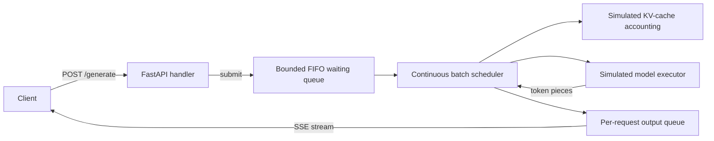

# LLM Inference Runtime

A miniature inference serving system inspired by vLLM, built to make scheduling
and concurrency understandable. Version 0.1 uses Python, FastAPI, asyncio, and a
**simulated executor** by default. An optional CPU backend now runs a small real
model; see [local model setup](LOCAL_MODEL.md). A text-only
[chat-compatible API](CHAT_API.md) accepts conversation histories and both
streamed and complete assistant responses. A [built-in browser client](BROWSER_CLIENT.md)
now provides local chat and live runtime activity at `/`.
An optional [native Android client](ANDROID_CLIENT.md) connects to the same API
with message bubbles, streamed replies, conversation history, and Stop. Connection
and reply-length controls live in Settings; inference stays on the Mac.
The CPU executor also has [experimental real tensor batching](TENSOR_BATCHING.md),
with the original unbatched path retained for comparison.
An [optional SDPA attention path](CPU_TUNING.md) is available independently;
normal startup retains eager attention.

## Run it

Requires Python 3.10 or newer (development verified with Python 3.12).

```bash
python3.12 -m venv .venv
source .venv/bin/activate
python -m pip install -e '.[dev]'
uvicorn llm_runtime.api:app --host 127.0.0.1 --port 8000
```

Open **http://127.0.0.1:8000/** for the browser client. This default command
runs the simulator; use [the real-model setup](LOCAL_MODEL.md) for actual answers.

Use one Uvicorn worker: every process owns a separate queue and scheduler. Multiple
workers would not share admission ordering or queue capacity.

In another terminal:

```bash
curl -N http://127.0.0.1:8000/generate \
  -H 'Content-Type: application/json' \
  -d '{"prompt":"hello world", "max_tokens":3}'
curl http://127.0.0.1:8000/health
```

`-N` disables curl's output buffering. API documentation is at `/docs`.
The POST endpoint streams Server-Sent Events (SSE):

```text
event: token
data: {"request_id": "...", "index": 0, "text": "hello "}

event: token
data: {"request_id": "...", "index": 1, "text": "world "}

event: token
data: {"request_id": "...", "index": 2, "text": "hello "}

event: done
data: {"request_id": "...", "generated_tokens": 3, "finish_reason": "length"}

```

Blank lines separate events. Token indices are zero-based; concatenate `text`
fields to reconstruct the output. The request ID is also in `X-Request-ID`.
A browser client should use streaming `fetch` because this endpoint uses POST;
native `EventSource` uses GET. Clients must handle frames split across network
chunks. Network chunks do not necessarily correspond to complete SSE events.

`prompt` must have 1–8192 characters. `max_tokens` is an integer from 1–512,
defaulting to 16. The simulator splits the prompt on whitespace and cycles its
words, appending a space to each generated piece. An all-whitespace prompt emits
`<empty> ` pieces. These pieces are called tokens for the exercise; they are not
real model tokens. The optional local backend uses real model tokens instead.
Generation normally stops at `max_tokens`; explicit cancellation can stop it earlier.
The simulator does not model EOS; the optional local backend does.

Invalid input or a request whose prompt-plus-output reservation exceeds total
KV-cache capacity returns HTTP 422. A full waiting queue or unavailable scheduler
returns HTTP 503 before a stream starts. After HTTP 200 begins, executor failures
and runtime shutdown are reported as terminal `event: error` frames, containing
`request_id` and `message`. HTTP status cannot change after headers are sent.
There is no automatic retry or durable request storage.

## Architecture



| Module | Responsibility |
| --- | --- |
| `api.py` | Generation transport, cancellation, health, application lifespan |
| `chat.py` | Text-only chat schemas, model discovery, compatible JSON/SSE mapping |
| `web/` | Same-origin browser chat, streaming parser, and runtime activity view |
| `protocol.py` | Input schema, internal request state, output events |
| `batching.py` | Bounded admission, configurable step planning, lifecycle, failure isolation |
| `scheduler.py` | Retained run-to-completion FCFS baseline and admission errors |
| `executor.py` | Executor interface and deterministic simulation |
| `local_executor.py` | Optional CPU tokenizer, cached greedy inference, per-request model state |
| `worker.py` | Serialized off-loop model work with cancellation settlement |
| `local.py`, `download_model.py` | Opt-in local server factory and pinned model download |
| `config.py` | Waiting/active/cache capacities, iteration token budget, simulation delays |
| `kv_cache.py` | Per-request token-slot reservations, usage, and release |
| `metrics.py` | Monotonic request timestamps and derived durations |
| `benchmark.py` | Closed-loop in-process workload client and JSON comparison reports |
| `http_benchmark.py` | Separate client measuring actual HTTP streaming receipt |
| `comparison.py` | Versioned mixed-prompt closed-loop experiments using the same strict HTTP client |

The application factory `create_app(config, executor)` supports isolated tests
and replacement executors. The scheduler depends on the `ModelExecutor` protocol,
not FastAPI. The executor executes explicit prefill/decode steps and knows nothing about HTTP or SSE.
This boundary supports the optional real executor without rewriting transport code.
The scheduler is created and stopped by FastAPI's lifespan, not at import time.

### Scheduling and concurrency

The API uses **continuous batching**: FIFO admission fills a bounded active set,
then each iteration selects work from that set. New waiting requests enter at the
next iteration boundary when a slot is available. Short requests can finish while
older long requests continue decoding. Admission is FIFO; completion is not.
The original `FCFSScheduler` remains available as a run-to-completion baseline.

Each request transitions through `waiting → prefill → decode → finished`, or
terminates as `cancelled` or `failed`. Prefill consumes prompt word pieces (at
least one for whitespace-only prompts); decode consumes one token per selected
request per iteration. Prefill does not emit tokens. The scheduler tracks offsets
and generation counts; the simulated executor is stateless between steps.

`RuntimeConfig` controls `queue_capacity=64`, `max_active_requests=8`, and
`token_budget=32`. The budget is shared by prefill and decode. Long prompts are
chunked to fit the remaining budget, so even a prompt longer than the budget can
progress. Each active request gets at most one step per iteration. Selection
rotates round-robin across iterations, including when the budget is smaller than
the active set; a large prefill cannot permanently starve existing decodes.
This default `scheduling_policy="round_robin"` remains a simple fair policy
without latency guarantees. An optional `decode_first` policy is described below.

Configure the application programmatically, for example:

```python
from llm_runtime.api import create_app
from llm_runtime.config import RuntimeConfig

app = create_app(RuntimeConfig(
    max_active_requests=4, token_budget=8, kv_cache_capacity_tokens=8192,
))
```

The scheduler owns runtime state on one event loop. Submission and cancellation
mutate it synchronously; one worker plans and executes iterations. Selected simulated steps run concurrently via
`asyncio.gather`, with a barrier before the next iteration. The prefill delay
(default 50 ms per prompt) is apportioned across chunks; each decode step sleeps
for 30 ms. These are illustrative delays, not hardware performance measurements.
A slow step delays its iteration, but requests no longer monopolize execution
until completion. Even zero-delay executors yield between iterations for HTTP
handling and new admissions. The optional local executor serializes its model forwards on a dedicated worker
thread, so these scheduled steps are not a fused model batch. Blocking inference
leaves the HTTP event loop free; shutdown waits for submitted model work to settle.

Replacement executors implement
`async execute(ExecutionStep) -> str | DecodeResult | None`: prefill returns
`None`, simulated decode returns text, and real decode returns text plus a model
token ID and optional EOS reason. Exceptions fail only the affected request.
Stateful executors may provide `tokenize(prompt)`, `context_limit`, synchronous
`release_request(id)`, async `aclose()`, and `info` metadata. The scheduler uses
model token IDs for prompt budgets and reservations when tokenization is supplied,
and calls release only after execution settles. The API lifespan closes executors
after scheduler shutdown, including startup failure. Async `executor_loader` avoids
loading weights at module import. Existing stateless executors still work.
The legacy `generate` interface remains only for the simulated FCFS baseline.

### Prefill/decode policy

Set `RuntimeConfig(scheduling_policy="decode_first", prefill_token_budget=8)` to
prioritize existing output streams and limit total prefill tokens per iteration.
The default remains `round_robin`, which ignores the prefill cap.

Decode-first selects decode work first. If both phases are active and the shared
budget is at least two, it protects one token for prefill, then uses the remainder
for decodes. Prefill receives the leftover shared budget up to its configured cap.
With a budget of one, mixed phases alternate starting with decode. Each phase
rotates its selected requests to the back, so resident requests get turns even
when more requests arrive. Each request still receives at most one step per
iteration, and total work stays within `token_budget`.

The prefill cap applies even when only prefills are active; unused budget can
remain intentionally. Caps above the shared budget are allowed and clamped during
planning. Both phases make progress, assuming selected executor steps return;
this is an iteration fairness rule, not a wall-clock latency guarantee. The
iteration barrier, FIFO memory admission, and KV ownership rules are unchanged.

Three recorded mixed-workload comparisons show shorter output-token gaps with
this policy, at the cost of lower throughput and higher first-token latency.
See [the policy experiment](benchmarks/scheduling-policy.md) before selecting it.

### Simulated KV cache

The continuous-batching scheduler owns a `SimulatedKVCache`, with
`kv_cache_capacity_tokens=8192` by default. Capacity is a positive integer in
logical token slots, not bytes or GPU memory. In real mode the counts use model
tokens including the chat template; actual KV tensors are owned by the executor
and reported separately. The FCFS baseline is unchanged.

Before admission, each request reserves `prompt_token_count + max_tokens` slots.
Usage starts at zero and grows by each successfully completed prefill chunk or
decode token. Whitespace-only prompts count as one prompt token. For example,
a three-token prompt requesting two outputs reserves five slots: usage progresses
`0 → 3 → 4 → 5`, then completion releases both usage and reservation. Counting
all generated outputs, including the final output, is a simulation convention;
it does not reproduce exact real-model KV timing.

At every boundary, `used ≤ reserved ≤ capacity`. Per-request allocation snapshots
are available through `scheduler.kv_cache.allocations`. Reservations protect future
growth, so admitted requests can finish without memory deadlock, assuming executor
steps return. Unused reservations can reduce concurrency. A request larger than
total capacity receives HTTP 422 before streaming and never enters the queue.
Temporary memory pressure keeps feasible requests waiting, with strict FIFO
admission: a large head request blocks smaller requests behind it. Waiting work
uses no cache, and the pending FIFO head still counts toward waiting capacity.
The configured scheduling policy and shared token budget continue for active requests.

Completion, executor failure, invalid decode output, abandonment, and shutdown all
release ownership through scheduler finalization. In-flight work retains its
reservation until the iteration barrier settles or shutdown cancellation finishes;
abandoned results consume no additional slots. Release occurs before terminal
events are consumed, so slow readers do not retain simulated KV memory.

`/health` includes `kv_cache` with `capacity_tokens`, `reserved_tokens`,
`used_tokens`, and `available_tokens` (capacity minus reservations). This bounds
only simulated cache slots: Python objects, prompt strings, and output queues
remain outside the bound. There is no paging, eviction, or prefix sharing. The optional real executor holds ordinary per-request
KV tensors; the logical cache manager does not allocate or bound physical RAM.

### Queueing, ownership, and cleanup

The waiting queue defaults to 64 requests, plus at most eight active requests.
Submission checks total waiting occupancy and uses `put_nowait`, so overload
gets an immediate 503 rather than an
unbounded accumulation of waiting work. Queue capacity excludes the active
request. The queue and scheduler belong to one event loop; submission is not
thread-safe.

Each request owns an output queue. With the supplied executor, output is bounded
by the API limit of 512 token events plus one terminal event. This queue is not
itself capacity-limited: it decouples a slow HTTP reader from scheduling, avoiding
one reader stalling every inference request. Completed requests with slow readers
can still retain memory, so this is not a global memory bound. Production serving
will need admission budgets and an explicit slow-consumer/backpressure policy.
Replacement executors must obey the generation limit.

HTTP cleanup marks disconnected requests as abandoned and notifies their owning
scheduler through the existing cancellation path. Waiting requests release their
queue slot as soon as the transport closure is handled, even when every active
slot is busy or the FIFO head is waiting for memory. Surviving waiters keep FIFO
order. Active work retains its resources until the selected execution barrier
settles; later results are discarded without emitting more events. This is
cooperative cleanup, without interruption of native model computation. Directly
setting a request's abandoned flag is still observed at execution/admission
boundaries; transport integrations should call the scheduler's `abandon()` method.
Shutdown cancels the worker, balances queue
bookkeeping, and places terminal errors on active and waiting request streams
unless explicit cancellation was already accepted. Delivery still
depends on the HTTP connection and ASGI server shutdown behavior.

Executor errors terminate only the affected request and are logged server-side;
the worker continues to subsequent requests. Stream error messages do not expose
exception details.

### Explicit cancellation

Use `POST /requests/{request_id}/cancel` to stop a live request. The ID is returned
in the generation response's `X-Request-ID` header and every stream event.
For a manual check, start generation with response headers visible:

```bash
curl -N -D - http://127.0.0.1:8000/generate \
  -H 'Content-Type: application/json' \
  -d '{"prompt":"hello world", "max_tokens":100}'
```

Copy the `X-Request-ID` value, then run in another terminal:

```bash
curl -X POST http://127.0.0.1:8000/requests/REQUEST_ID/cancel
```

An accepted cancellation returns HTTP 202 with
`{"request_id":"...","status":"cancellation_requested"}`. This acknowledges
acceptance, not immediate interruption of execution. Unknown or already finalized
IDs return HTTP 404; an unavailable or stopping runtime returns HTTP 503.

Waiting requests, including the pending memory-blocked FIFO head, are finalized
immediately and release their waiting slot without reordering survivors. Active
requests remain owned until an iteration boundary. Their in-flight results are
discarded, and KV reservations are released only after the iteration barrier
settles (or shutdown cancellation settles). There is no executor task interruption
per request, so a stuck executor step still delays active cancellation.

A connected stream ends with exactly one `done` event containing
`finish_reason: "cancelled"`, the number of tokens generated before cancellation,
and timing data. Tokens already buffered before cancellation can still arrive;
no further execution results are emitted once cancellation is observed. Explicit
cancellation accepted before an execution failure, final decode result, or shutdown
wins that race. If completion or failure finalized first, cancellation returns 404.
Disconnected streams emit no additional terminal event.

Repeated cancellation of an active request returns 202 until finalization. Waiting
cancellation finalizes immediately, so its next cancellation returns 404. A live
request registry is bounded by active plus waiting capacity; finalization removes
the entry even if the output reader is slow. Terminal IDs are not retained across
completion or restart. Cancellation runs on the same event loop as scheduling and
is not thread-safe. The retained FCFS baseline has no cancellation endpoint.

## Tests

```bash
source .venv/bin/activate
python -m pytest -q
```

Tests cover the retained FCFS baseline, deterministic generation, continuous
admission, shared budgets, prefill chunking, round-robin fairness, active and
waiting limits, shutdown/restart, explicit waiting/active cancellation and races,
abandonment in both phases, isolated execution
failures, KV capacity invariants, FIFO memory pressure, partial usage and release,
HTTP disconnects, validation, health, SSE payloads, and incremental
streaming. Synchronization gates control
execution rather than relying on sleeps or timing thresholds. HTTPX's in-process
ASGI transport buffers response bodies, so a separate direct ASGI test verifies
that the first token is sent while generation is still paused.

For a manual concurrency experiment, run two curl generation requests in separate
terminals. Give the first 100 tokens and the second 2. The second stream can
finish while the first is still decoding. `/health` exposes waiting queue size,
`active_requests`, and `active_request_ids`. The legacy `active_request_id` field
is retained as a single representative ID; its order can rotate between
iterations. This experiment is not a performance benchmark.

## Measurements and repeatable benchmark

Both schedulers record monotonic timestamps per request. Successful SSE `done`
events include an additive `timings` object (all durations in milliseconds):

| Field | Definition |
| --- | --- |
| `queue_wait_ms` | Submission to active admission, including waiting for KV capacity |
| `time_to_first_token_ms` | Submission to first scheduler token emission, including queue wait |
| `inter_token_ms` | List of gaps between consecutive scheduler token emissions |
| `end_to_end_ms` | Submission to scheduler finalization |

These measure scheduler events, not client receipt or SSE transmission. Batch
results are processed after the iteration barrier, so emission times include
barrier delays. Raw monotonic timestamps stay internal: their origin is not a
wall-clock time. Timings are available on `request.timings` for failures and
cancellation, too; an unreached admission, first token, or finalization is `null`,
and fewer than two tokens produce an empty gap list. No global request history is
retained. Rejected submissions never acquire request metrics.

Run the deterministic benchmark without starting Uvicorn:

```bash
python -m llm_runtime.benchmark --scheduler both --requests 12 --concurrency 4 \
  --warmup 2 --prefill-delay 0.01 --token-delay 0.005
```

The benchmark clients call scheduler submission and consume internal output queues
in process. It excludes HTTP, networking, real tokenization, and GPU execution.
It supports FCFS, continuous batching, or both sequentially; each mode gets a
fresh scheduler and the same workload/configuration. FCFS still has no KV-memory
enforcement. A fixed number of client workers each submit their next request
when the previous one terminates (closed loop), with no automatic retries.
`--output-tokens 2 16` repeats short/long output lengths in submission order;
`--prompt-words 8` fixes every prompt to eight simulated words, while
`--prompt-words 2 64` alternates short and long prompts. Both patterns repeat by
submission index independently. `--scheduler policies` compares round-robin and
decode-first continuous batching with per-run configurations. JSON schema version
2 records prompt token counts in every request row. Use `--help` for
queue, active, token-budget, cache-capacity, delays, and deadline controls.

JSON reports contain configuration, Python/platform details, raw per-request
samples, elapsed measurement time, completion/rejection/error/timeout counts,
completed requests/s and tokens/s, and mean/p50/p95/p99 latency statistics.
Percentiles use nearest rank; empty populations return `null`. Inter-token
statistics pool all token gaps, so longer outputs contribute more samples.
Latency distributions include completed requests only, and throughput counts
only their outputs over the full measured interval. Warmup is excluded; a failed
warmup aborts the run. Measured failures remain visible and cause CLI exit code 1.
A per-request timeout marks the request abandoned; its snapshot may have no
finalization time because cleanup is cooperative. Stop always drains the runtime.

Recorded examples are in [benchmarks/README.md](benchmarks/README.md). They are
single-run simulator observations, not performance guarantees. Repeat runs and
compare equivalent workloads before choosing a scheduling change. The new
[external HTTP benchmark](BROWSER_CLIENT.md#measure-the-external-http-path) measures
client receipt separately; recorded real CPU results are in
[benchmarks/http-local.md](benchmarks/http-local.md).

## Development roadmap

Work in small milestones, preserving a runnable server and recording results in
[PROGRESS.md](PROGRESS.md). Advanced features are proposals, not implemented APIs.

| Milestone | Change | Evidence of completion |
| --- | --- | --- |
| 1 — FCFS baseline (retained) | HTTP, bounded queue, simulated executor, SSE | Ordering, streaming, overload, lifecycle tests pass |
| 2 — Measurement (implemented) | Request timestamps and in-process benchmark client | Clock-controlled timing tests; recorded FCFS/continuous runs at concurrency 1 and 4 |
| 3 — Step-based execution (implemented) | Explicit waiting/active/finished state; separate prefill/decode steps | Preserve FCFS baseline behavior; deterministic state-transition tests |
| 4 — Continuous batching (implemented) | Admit requests between decode steps; bounded active batch | Show short requests progressing alongside long requests; compare with baseline |
| 5 — Prefill/decode scheduling (implemented) | Optional decode-first policy with capped prefill and phase fairness | Starvation/lifecycle tests and three mixed-workload comparisons |
| 6 — Simulated KV cache (implemented) | Token-slot reservations, progressive usage, FIFO memory admission, lifecycle release | Capacity invariants, no leaks, exhaustion, HTTP health and rejection tests |
| 7 — Explicit cancellation (implemented) | Live request lookup, cancellation endpoint, terminal lifecycle | Immediate waiting-slot release, active boundary cleanup, race and SSE tests |
| 8 — Optional real executor (CPU implemented) | SmolLM2 local tokens, greedy cached steps, serialized worker | Offline reference tests, real checkpoint smoke, live SSE and cancellation checks |
| 9 — Chat-compatible adapter (implemented) | Model discovery, text message history, JSON/streamed completions | Validation, usage, lifecycle tests; real multi-turn reference and live HTTP checks |
| 10 — External measurement and browser client (implemented) | Built-in chat with runtime view; separate HTTP streaming client | Real Chrome history/Stop/two-client checks, mobile layout, recorded receipt timings |
| 11 — Engine comparison research (complete) | Sourced review of vLLM, SGLang, llama.cpp, and MLX LM; local comparison protocol | [Findings and pinned sources](research/engine-comparison/README.md); [experiment plan](research/engine-comparison/EXPERIMENT_PLAN.md); measurements followed in milestone 14 |
| 12 — Portable benchmark preflight (implemented) | Explicit model selection, configurable readiness, portable profile, usage policies, excluded streaming compatibility check | [Protocol and real-model smoke evidence](benchmarks/http-compatibility.md); external engine verification in milestone 13 |
| 13 — External engine compatibility (verified) | Pinned CPU-only llama.cpp build, float32 conversion, prompt equivalence, real HTTP smoke | [272 tensor checks, four prompt fixtures, eight completed smoke requests](benchmarks/llama-cpp.md); repeated comparison in milestone 14 |
| 14 — Repeated CPU comparison (complete) | Five repetitions of short/long/mixed workloads at concurrency 1/2; separate disconnect, RSS, and token-admission probes | [640 measured completions, 383 tests, raw data, and a queued-disconnect finding](benchmarks/cpu-comparison.md) |
| 15 — Queued disconnect cleanup (implemented) | HTTP closure immediately cancels waiting work; active ownership remains protected by its barrier | [411 tests and three real CPU trials reclaiming a waiter with both active slots busy](benchmarks/disconnect-cleanup.md) |
| 16 — Retained-memory profiling (complete) | Two normal 30-wave runs and a separate weak-reference/Python/native diagnostic session | [364 completed requests, 433 tests, memory chart, and limits](benchmarks/retained-memory.md); no per-request GC/allocator policy added |
| 17 — Larger-model compatibility (verified) | Pinned Qwen2.5-0.5B selection; reference/HTTP/concurrency/cancellation checks using the existing CPU executor | [444 tests, two model architectures, raw samples, and quality limits](benchmarks/qwen-0.5b/README.md); tensor batching remains next |
| 18 — Native Android client (implemented) | Kotlin chat app using existing model discovery, streamed chat, history, and cancellation endpoints | [Build/run guide and verification](ANDROID_CLIENT.md); no model or inference framework on the phone |
| 19 — Android chat presentation (implemented) | Message bubbles, bottom Send/Stop composer, welcome prompts, Settings, and system light/dark themes | [Interface guide](ANDROID_CLIENT.md#chat-screen-and-settings); inference and API behavior unchanged |
| 20 — Experimental real tensor batching (implemented) | Shared CPU prefill/decode forwards, padded masks/positions, owned per-request cache splits, and the existing cancellation barrier | [Architecture and activation](TENSOR_BATCHING.md); [CPU measurements](benchmarks/tensor-batching/README.md); remains opt-in |
| 21 — CPU operator profiling and optional SDPA (implemented) | Shape-aware CPU profiles, attention/thread screening, explicit attention selection, and independent eager references | [Guide](CPU_TUNING.md); [recorded comparison](benchmarks/cpu-attention/README.md); eager/unbatched defaults unchanged |

Continuous batching was prioritized before the measurement milestone at user
request; simulated KV-cache accounting and measurements followed. Recorded
simulator comparisons are available above; no GPU performance improvement is
claimed. Shared token budgets and the initial fair prefill policy are implemented.

Introduce only the abstractions each milestone needs. In particular, do not add a
paged allocator before cache capacity and ownership are modeled. Explicit
cancellation now coordinates scheduler state and KV-cache release. Benchmark
simulated and real execution separately; simulated throughput
is an event-loop/scheduling experiment, not a GPU performance claim.

This project borrows the serving concepts of vLLM; it is not compatible with its
API, scheduler implementation, or performance characteristics. Authentication,
production observability, distributed scheduling, persistence, fused model batches,
paged KV tensors, and GPU execution remain outside the current runtime.
