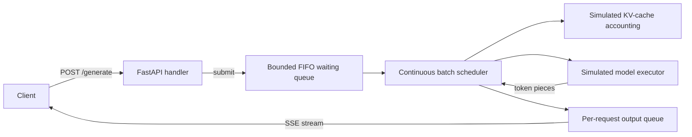

# LLM Inference Runtime

A miniature inference serving system inspired by vLLM, built to make scheduling
and concurrency understandable. Version 0.1 uses Python, FastAPI, asyncio, and a
**simulated executor**. It does not load model weights or perform real inference.

## Run it

Requires Python 3.10 or newer (development verified with Python 3.12).

```bash
python3.12 -m venv .venv
source .venv/bin/activate
python -m pip install -e '.[dev]'
uvicorn llm_runtime.api:app --host 127.0.0.1 --port 8000
```

Use one Uvicorn worker: every process owns a separate queue and scheduler. Multiple
workers would not share admission ordering or queue capacity.

In another terminal:

```bash
curl -N http://127.0.0.1:8000/generate \
  -H 'Content-Type: application/json' \
  -d '{"prompt":"hello world", "max_tokens":3}'
curl http://127.0.0.1:8000/health
```

`-N` disables curl's output buffering. API documentation is at `/docs`.
The POST endpoint streams Server-Sent Events (SSE):

```text
event: token
data: {"request_id": "...", "index": 0, "text": "hello "}

event: token
data: {"request_id": "...", "index": 1, "text": "world "}

event: token
data: {"request_id": "...", "index": 2, "text": "hello "}

event: done
data: {"request_id": "...", "generated_tokens": 3, "finish_reason": "length"}

```

Blank lines separate events. Token indices are zero-based; concatenate `text`
fields to reconstruct the output. The request ID is also in `X-Request-ID`.
A browser client should use streaming `fetch` because this endpoint uses POST;
native `EventSource` uses GET. Clients must handle frames split across network
chunks. Network chunks do not necessarily correspond to complete SSE events.

`prompt` must have 1–8192 characters. `max_tokens` is an integer from 1–512,
defaulting to 16. The simulator splits the prompt on whitespace and cycles its
words, appending a space to each generated piece. An all-whitespace prompt emits
`<empty> ` pieces. These pieces are called tokens for the exercise; they are not
real model tokens. Generation always stops at `max_tokens`; EOS is not modeled.

Invalid input or a request whose prompt-plus-output reservation exceeds total
KV-cache capacity returns HTTP 422. A full waiting queue or unavailable scheduler
returns HTTP 503 before a stream starts. After HTTP 200 begins, executor failures
and runtime shutdown are reported as terminal `event: error` frames, containing
`request_id` and `message`. HTTP status cannot change after headers are sent.
There is no automatic retry or durable request storage.

## Architecture



| Module | Responsibility |
| --- | --- |
| `api.py` | Validation, HTTP errors, SSE framing, application lifespan |
| `protocol.py` | Input schema, internal request state, output events |
| `batching.py` | Bounded admission, round-robin step planning, lifecycle, failure isolation |
| `scheduler.py` | Retained run-to-completion FCFS baseline and admission errors |
| `executor.py` | Executor interface and deterministic simulation |
| `config.py` | Waiting/active/cache capacities, iteration token budget, simulation delays |
| `kv_cache.py` | Per-request token-slot reservations, usage, and release |

The application factory `create_app(config, executor)` supports isolated tests
and replacement executors. The scheduler depends on the `ModelExecutor` protocol,
not FastAPI. The executor executes explicit prefill/decode steps and knows nothing about HTTP or SSE.
This boundary allows a real executor later without rewriting transport code.
The scheduler is created and stopped by FastAPI's lifespan, not at import time.

### Scheduling and concurrency

The API uses **continuous batching**: FIFO admission fills a bounded active set,
then each iteration selects work from that set. New waiting requests enter at the
next iteration boundary when a slot is available. Short requests can finish while
older long requests continue decoding. Admission is FIFO; completion is not.
The original `FCFSScheduler` remains available as a run-to-completion baseline.

Each request transitions through `waiting → prefill → decode → finished`, or
terminates as `cancelled` or `failed`. Prefill consumes prompt word pieces (at
least one for whitespace-only prompts); decode consumes one token per selected
request per iteration. Prefill does not emit tokens. The scheduler tracks offsets
and generation counts; the simulated executor is stateless between steps.

`RuntimeConfig` controls `queue_capacity=64`, `max_active_requests=8`, and
`token_budget=32`. The budget is shared by prefill and decode. Long prompts are
chunked to fit the remaining budget, so even a prompt longer than the budget can
progress. Each active request gets at most one step per iteration. Selection
rotates round-robin across iterations, including when the budget is smaller than
the active set; a large prefill cannot permanently starve existing decodes.
This is a simple fair policy, without decode priority or latency guarantees.

Configure the application programmatically, for example:

```python
from llm_runtime.api import create_app
from llm_runtime.config import RuntimeConfig

app = create_app(RuntimeConfig(
    max_active_requests=4, token_budget=8, kv_cache_capacity_tokens=8192,
))
```

One scheduler task owns all state. Selected simulated steps run concurrently via
`asyncio.gather`, with a barrier before the next iteration. The prefill delay
(default 50 ms per prompt) is apportioned across chunks; each decode step sleeps
for 30 ms. These are illustrative delays, not hardware performance measurements.
A slow step delays its iteration, but requests no longer monopolize execution
until completion. Even zero-delay executors yield between iterations for HTTP
handling and new admissions. A real executor would need a true batched model-step
interface and appropriate integration for blocking CPU/GPU work.

Replacement executors implement `async execute(ExecutionStep) -> str | None`:
prefill returns `None`, decode returns one text piece. Exceptions fail only the
affected request. The legacy `generate` interface is used only by the FCFS
baseline. No model weights, GPU tensors, or real tokenizer are involved.

### Simulated KV cache

The continuous-batching scheduler owns a `SimulatedKVCache`, with
`kv_cache_capacity_tokens=8192` by default. Capacity is a positive integer in
simulated token slots, not bytes or GPU memory. The FCFS baseline is unchanged.

Before admission, each request reserves `prompt_token_count + max_tokens` slots.
Usage starts at zero and grows by each successfully completed prefill chunk or
decode token. Whitespace-only prompts count as one prompt token. For example,
a three-token prompt requesting two outputs reserves five slots: usage progresses
`0 → 3 → 4 → 5`, then completion releases both usage and reservation. Counting
all generated outputs, including the final output, is a simulation convention;
it does not reproduce exact real-model KV timing.

At every boundary, `used ≤ reserved ≤ capacity`. Per-request allocation snapshots
are available through `scheduler.kv_cache.allocations`. Reservations protect future
growth, so admitted requests can finish without memory deadlock, assuming executor
steps return. Unused reservations can reduce concurrency. A request larger than
total capacity receives HTTP 422 before streaming and never enters the queue.
Temporary memory pressure keeps feasible requests waiting, with strict FIFO
admission: a large head request blocks smaller requests behind it. Waiting work
uses no cache, and the pending FIFO head still counts toward waiting capacity.
Round-robin execution and the shared token budget continue for active requests.

Completion, executor failure, invalid decode output, abandonment, and shutdown all
release ownership through scheduler finalization. In-flight work retains its
reservation until the iteration barrier settles or shutdown cancellation finishes;
abandoned results consume no additional slots. Release occurs before terminal
events are consumed, so slow readers do not retain simulated KV memory.

`/health` includes `kv_cache` with `capacity_tokens`, `reserved_tokens`,
`used_tokens`, and `available_tokens` (capacity minus reservations). This bounds
only simulated cache slots: Python objects, prompt strings, and output queues
remain outside the bound. There is no paging, eviction, prefix sharing, actual
cache tensor allocation, or explicit cancellation endpoint.

### Queueing, ownership, and cleanup

The waiting queue defaults to 64 requests, plus at most eight active requests.
Submission checks total waiting occupancy and uses `put_nowait`, so overload
gets an immediate 503 rather than an
unbounded accumulation of waiting work. Queue capacity excludes the active
request. The queue and scheduler belong to one event loop; submission is not
thread-safe.

Each request owns an output queue. With the supplied executor, output is bounded
by the API limit of 512 token events plus one terminal event. This queue is not
itself capacity-limited: it decouples a slow HTTP reader from scheduling, avoiding
one reader stalling every inference request. Completed requests with slow readers
can still retain memory, so this is not a global memory bound. Production serving
will need admission budgets and an explicit slow-consumer/backpressure policy.
Replacement executors must obey the generation limit.

Stream cleanup marks disconnected requests as abandoned. Queued abandoned work
is skipped; active work is removed at iteration boundaries. Results from a step
that finishes after abandonment are discarded without emitting more events. This is
cooperative cleanup, with no explicit cancellation endpoint, immediate queue
removal, or GPU interruption. Abandoned waiting requests retain their queue slot
until dequeued. Shutdown cancels the worker, balances queue bookkeeping, and
places terminal errors on active and waiting request streams. Delivery still
depends on the HTTP connection and ASGI server shutdown behavior.

Executor errors terminate only the affected request and are logged server-side;
the worker continues to subsequent requests. Stream error messages do not expose
exception details.

## Tests

```bash
source .venv/bin/activate
python -m pytest -q
```

Tests cover the retained FCFS baseline, deterministic generation, continuous
admission, shared budgets, prefill chunking, round-robin fairness, active and
waiting limits, shutdown/restart, abandonment in both phases, isolated execution
failures, KV capacity invariants, FIFO memory pressure, partial usage and release,
HTTP disconnects, validation, health, SSE payloads, and incremental
streaming. Synchronization gates control
execution rather than relying on sleeps or timing thresholds. HTTPX's in-process
ASGI transport buffers response bodies, so a separate direct ASGI test verifies
that the first token is sent while generation is still paused.

For a manual concurrency experiment, run two curl generation requests in separate
terminals. Give the first 100 tokens and the second 2. The second stream can
finish while the first is still decoding. `/health` exposes waiting queue size,
`active_requests`, and `active_request_ids`. The legacy `active_request_id` field
is retained as a single representative ID; its order can rotate between
iterations. This experiment is not a performance benchmark.

## Development roadmap

Work in small milestones, preserving a runnable server and recording results in
[PROGRESS.md](PROGRESS.md). Advanced features are proposals, not implemented APIs.

| Milestone | Change | Evidence of completion |
| --- | --- | --- |
| 1 — FCFS baseline (retained) | HTTP, bounded queue, simulated executor, SSE | Ordering, streaming, overload, lifecycle tests pass |
| 2 — Measurement | Request timestamps and benchmark client | Measure queue wait, time to first token, inter-token latency, end-to-end latency, throughput; record concurrency and workload |
| 3 — Step-based execution (implemented) | Explicit waiting/active/finished state; separate prefill/decode steps | Preserve FCFS baseline behavior; deterministic state-transition tests |
| 4 — Continuous batching (implemented) | Admit requests between decode steps; bounded active batch | Show short requests progressing alongside long requests; compare with baseline |
| 5 — Prefill/decode scheduling | Refine the shared token budget and fair prefill policy | Compare throughput and tail latency; test starvation and fairness |
| 6 — Simulated KV cache (implemented) | Token-slot reservations, progressive usage, FIFO memory admission, lifecycle release | Capacity invariants, no leaks, exhaustion, HTTP health and rejection tests |
| 7 — Explicit cancellation | Request lookup, lifecycle transitions, cancellation API | Cancel waiting and active requests; verify cleanup and race handling |
| 8 — Optional real executor | Integrate a small model behind an evolved executor interface | Correct output/lifecycle and measured hardware behavior |

Continuous batching was prioritized before the measurement milestone at user
request; simulated KV-cache accounting followed. No benchmark or throughput
improvement is claimed. Shared token budgets
and the initial fair prefill policy are included in this milestone.

Introduce only the abstractions each milestone needs. In particular, do not add a
paged allocator before cache capacity and ownership are modeled. Later cancellation
work must coordinate scheduler state and KV-cache release, beyond today's stream
cleanup. Benchmark simulated and real execution separately; simulated throughput
is an event-loop/scheduling experiment, not a GPU performance claim.

This project borrows the serving concepts of vLLM; it is not compatible with its
API, scheduler implementation, or performance characteristics. Authentication,
production observability, distributed scheduling, persistence, real tokenization,
real KV tensor caching, and real model execution remain outside the current runtime.
