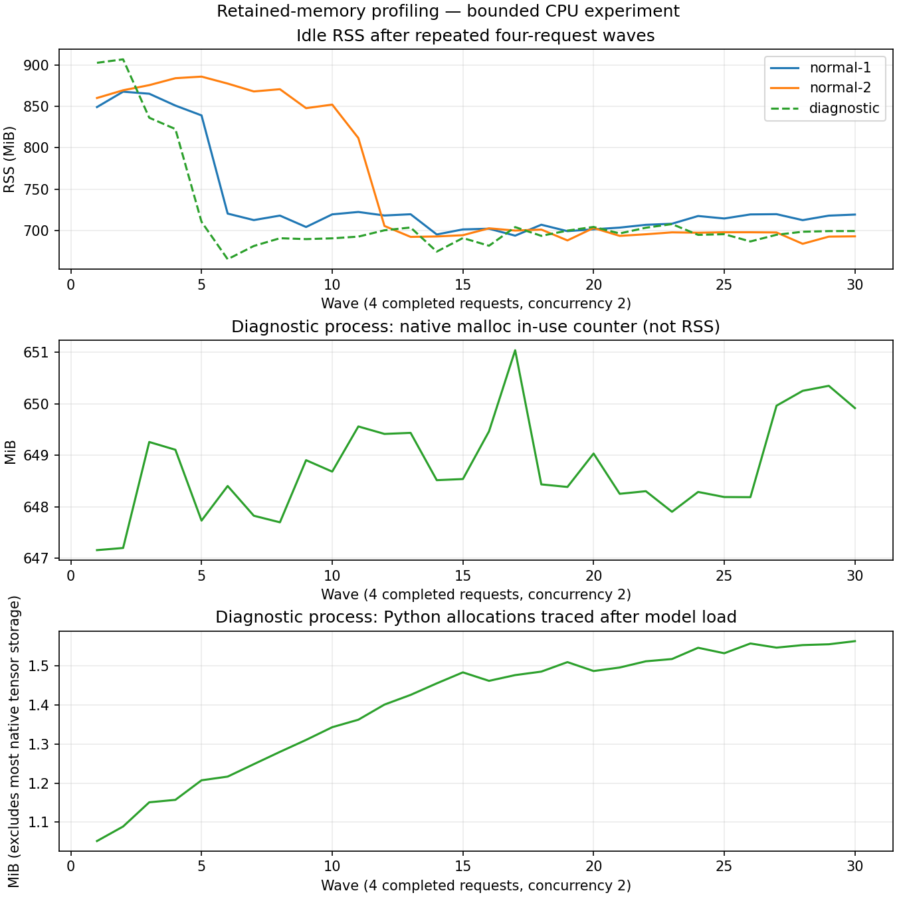

# Retained CPU memory investigation — 2026-11-10

The earlier [CPU comparison](cpu-comparison.md) saw process RSS rise over five
short workload waves even after tracked KV memory returned to zero. This phase
extends that observation and checks object lifetimes before proposing a fix.

**Outcome:** the bounded tests do not show accumulating released KV objects.
Normal-server RSS rose during warmup and later fell without forced cleanup.
There is no evidence here to justify adding per-request garbage collection or
allocator trimming. No normal runtime/executor implementation changed.

## What the different memory numbers mean

- **Model weights** are the trained numbers kept loaded so the next request can
  run. They intentionally remain after an individual answer finishes.
- **KV tensors** are each request's model working context. These should lose
  their owners after completion/cancellation and safe execution settlement.
- **Python-traced allocations** cover allocations observed after tracing starts.
  They exclude earlier imports/model loading and most native tensor storage.
- **Native malloc counters** describe allocator activity inside the process.
  They do not equal resident RAM; the reported fields are not additive to RSS.
- **RSS** is the OS-reported resident portion of a process. It includes more than
  live request tensors and can change without a corresponding new/live request.

In everyday terms: finishing a job clears its working notes, but the engine keeps
the model and its libraries loaded. The operating system's resident-memory figure
is not a direct count of those notes.

## Experiment

Used the existing Apple M3 / 16 GB Mac, CPU float32 SmolLM2 checkpoint, two model
threads, two active slots, and the exact mixed workload from
[cpu-workloads-v1.json](cpu-workloads-v1.json): longer prompt, short question,
larger-output case, short question. No new checkpoint or dependency was installed.

- Two fresh **normal server** sessions each ran 30 waves / 120 requests. These
  used the existing production factory with no weak observers, tracing, forced
  GC, or allocator intervention. RSS and health were sampled only between waves.
- A separate **diagnostic server** session ran the same 30 waves / 120 requests.
  Instance-local wrappers observed requests, released `_Sequence` objects, and
  released K/V Tensor wrappers through weak references. Weak references do not
  keep these objects alive; dead observer entries are compacted every snapshot.
- Tracing began after model loading. A snapshot after wave 1 anchored Python
  allocation differences. The child recorded idle ownership, native malloc,
  GC, model-parameter lifetime, and weak-object counters between waves.
- Each session included five idle observations after its waves. The diagnostic
  session then ran one explicit `gc.collect()` probe, one best-effort native
  allocator-relief probe, and a four-request recovery wave. All child servers
  were stopped; the diagnostic factory recorded lifetimes after model cleanup.

All **364 workload requests completed successfully**. Every idle health snapshot
had zero registered/active/queued requests, logical reserved/used tokens, and
tracked KV bytes. These are memory observations, not new timing benchmarks or
transient-peak measurements. The instrumented process has observer overhead and
cannot be treated as an equivalent performance control.

These fresh sessions use completed requests and idle-only sampling. The earlier
comparison's memory session ran cancellation probes first and polled during work.
Host conditions and the queued-disconnect implementation also differ by revision.
This is not an exact replay of every earlier allocation/residency condition or a
before/after memory-optimization claim.

The private diagnostic factory lives under `scripts/`. Its `/__memory` controls
exist only when that factory is explicitly launched by the experiment. They are
not installed on the normal runtime/browser server. GC/allocator operations
refuse non-idle work. The macOS API is documented in Apple's
[malloc header](https://github.com/apple-oss-distributions/libmalloc/blob/main/include/malloc/malloc.h);
the installed SDK header hash and host are recorded in
[native-api.json](retained-memory-v1/native-api.json). Passing a null zone examines
all zones in this child process; a zero relief goal requests best effort. This
does not create host-wide memory pressure or impose a physical RAM cap.

## Results



Each wave contains four completed requests. The chart ends before explicit GC
or allocator probes. Axes have different scales; traced Python bytes are not total
Python process memory and the curves are not quantities to add together.

| Session | RSS after wave 1, MiB | Highest idle-wave RSS, MiB | RSS after wave 30, MiB | Last 10 waves, MiB |
| --- | ---: | ---: | ---: | ---: |
| Normal 1 | 849.12 | 867.72 | 719.31 | 703.58–719.78 |
| Normal 2 | 860.08 | 885.92 | 693.02 | 684.02–697.94 |
| Diagnostic | 902.61 | 906.80 | 699.44 | 686.84–707.80 |

Both normal sessions ended below their first-wave RSS without manual cleanup.
This rules out interpreting the original five-wave rise as sufficient evidence
of a steadily growing request-cache leak. It does **not** prove a permanent
steady-state plateau: normal session 1's last ten observations still rose by
about 16 MiB, and this finite workload cannot establish a global memory bound.
OS residency and allocator behavior were not individually isolated as causes.

### Object ownership

During the 120-request diagnostic workload:

- **120 released sequence objects and 7,200 released K/V Tensor wrappers** were
  observed. At every idle snapshot, none of those released objects remained alive.
- No executor sequence state, live registry entry, reservation, or tracked KV
  bytes remained between waves.
- One completed request object stayed alive while the scheduler was idle. That
  count was exactly one after every wave rather than accumulating with requests.
  Inspection of the scheduler shows its suspended loop retains last-iteration
  locals; this is consistent with the observed bounded tail reference. The
  observer does not establish a complete reference graph or all native ownership.
- All **272 model parameter objects** stayed alive while the model was loaded.
  After shutdown, the model and parameter weak references were dead, and the
  completed-request weak count was zero. The recovery wave increased lifetime
  observation totals to 124 sequences / 7,440 K/V wrappers, also dead at shutdown.

Tensor-wrapper lifetime is useful evidence, but by itself does not account for
every native allocation or prove all storage has returned to the OS. It supports
the narrower conclusion that the executor is not accumulating those released
cache objects in this run.

### Python and native allocations

Post-load traced Python allocation snapshots rose from about **1.05 to 1.56 MiB**
across the waves. The largest recorded positive differences were in PyTorch
pytree utilities and Transformers' Llama code, with smaller differences in
asyncio, tracing, and masking helpers. These are allocation sites, not proof that
any library is leaking.

At the explicit GC probe, 502 objects were collected and traced current bytes
fell from about **1.53 to 0.97 MiB**. The RSS observation moved from approximately
**699 to 841 MiB**, rather than decreasing. Observer/intervention effects and
residency changes prevent treating this as a controlled causal decomposition.
It does not provide evidence of a useful per-request RAM reduction from forced GC.

The native malloc in-use counter fluctuated by a few MiB across the diagnostic
waves, around **647–651 MiB**. The one allocator-relief call reported **zero bytes
released**; the following RSS snapshot was about 847 MiB. That best-effort result
does not prove there is no reusable memory or identify every retained page. The
recovery wave succeeded after both interventions.

After model shutdown, the native in-use counter was about **140.5 MiB**, alongside
dead model/parameter references. Frameworks and the profiling process were still
loaded for that final snapshot; the child then exited. Native counters and RSS
have different accounting semantics, so this is not an exact byte-for-byte
explanation of the model-weight allocation.

## Decision and limits

Keep the normal runtime's memory cleanup as it is. We have direct evidence of
released per-request objects, zero tracked ownership, collectible small Python
growth, and falling RSS during longer normal runs. A forced-GC or allocator-trim
policy has no demonstrated benefit here and would be an unsupported change.

The remaining explanation is deliberately limited: the earlier RSS rise was not
enough to identify a leak, and these results are consistent with warmup, transient
allocations, and changing process residency. They do not uniquely attribute every
retained byte, prove leak freedom over hours/different shapes, or replace peak
memory/overload testing. This is CPU-only; no GPU allocator was measured.

Next: implement and measure **real tensor batching**, keeping these memory/lifetime
checks as a baseline. Compare larger-output throughput and short-request latency
under mixed load, then repeat bounded memory/cancellation checks before claiming
an improvement. Consider releasing last-iteration request references earlier only
as a separate targeted change; they are not shown to explain the RSS increase.

## Records and reproduction

[retained-memory-v1/README.md](retained-memory-v1/README.md) indexes the raw sessions,
summary, source/checkpoint hashes, native API provenance, shutdown snapshot, and
chart. The driver checkpoints waves and stops child processes in `finally`.
The summarizer refuses incomplete/failed or inconsistent sessions.

From the repository root, using existing local/dev dependencies and checkpoint,
with loopback port 8021 free:

```bash
.venv/bin/python -m scripts.profile_runtime_memory \
  --output-dir .experiments/memory-recheck --waves 30 --normal-repetitions 2
.venv/bin/python -m scripts.summarize_memory_profile \
  .experiments/memory-recheck --output .experiments/memory-recheck/summary.json
.venv/bin/python -m pytest -q
```

This experiment's native counters/probe require macOS. Use a fresh output
directory. Optional plotting uses `scripts/plot_memory_profile.py` with an
interpreter that already has matplotlib; the recorded PNG used the pre-existing
base interpreter with matplotlib 3.9.2, without adding a project dependency.

Validation: **433 pytest cases passed**, including weak-reference non-retention,
observer compaction, busy-state intervention refusal, no diagnostic routes on
the normal server, archived-summary reproduction, and rejection of malformed or
incomplete experiment evidence. The optional chart was visually inspected.
